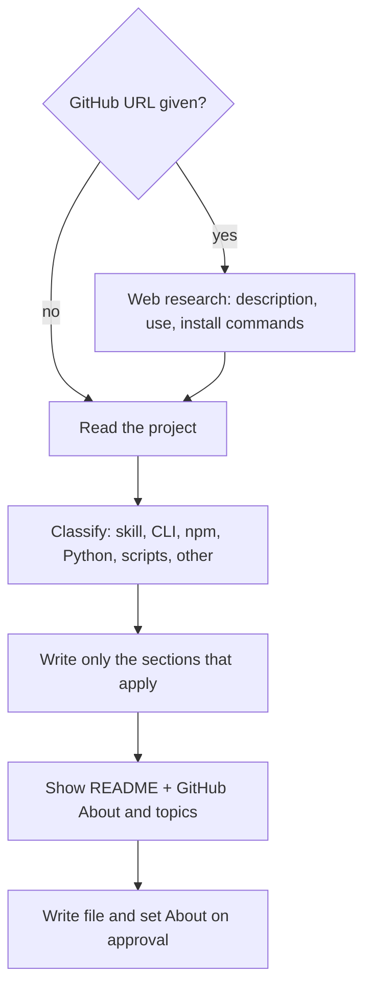

# readme-generator

A Claude Code skill that reads a repo and writes its README.md in one pass. It writes no placeholder or TODO sections.

## Install

```bash
git clone https://github.com/b1rdmania/readme-generator ~/.claude/skills/readme-generator
```

## Usage

```
/readme-generator                                  # current directory
/readme-generator https://github.com/user/repo     # research the repo on the web first
/readme-generator --update                         # update an existing README.md
```

## What it does



- Reads config files, entry points, `SKILL.md`, `CLAUDE.md` and any existing README
- Picks a section set for the project type and skips sections it cannot fill
- Writes a GitHub About line (160 characters or fewer) and 3 to 6 topics for any repo with a GitHub remote
- Adds one Mermaid flowchart when the project has a real multi-step flow
- Removes filler words such as "powerful", "robust" and "seamless"

## What it doesn't do

- Does not run the project to test the commands. Check them before you publish.
- Does not make screenshots or demo GIFs.
- Does not overwrite a README.md, or edit the GitHub About, without your approval.

## Requirements

Web research is optional. The skill uses the Exa MCP if it is configured, then the built-in WebSearch and WebFetch. With no search tool, it reads the local files only.

## License

Apache-2.0. Forked from [GLINCKER/claude-code-marketplace](https://github.com/GLINCKER/claude-code-marketplace).
