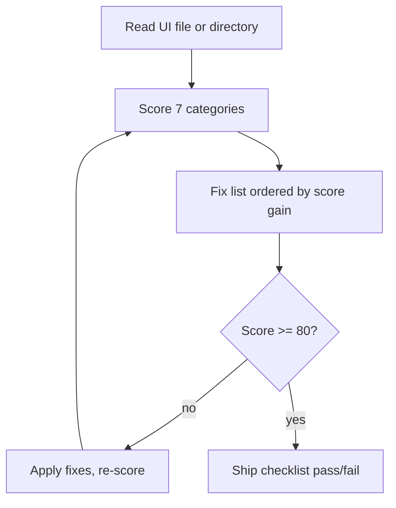

# README Generator

Reads the project, writes the README. One pass, no placeholders, no TODO sections.

## Commands

```
/readme-generator                         # generate for current directory
/readme-generator <github-url>            # research the repo on the web first, then generate
/readme-generator --update                # update an existing README.md
```

---

## Instructions

### Step 0 — Research (if GitHub URL provided)

If the user provides a GitHub URL, research it on the web before reading any local files. Use the Exa MCP if it is configured. If not, use WebSearch and WebFetch.

Run in parallel:

**Query 1 — What the repo is and how people talk about it**
```
fetch: [repo-url] — get the repo description, topics, star count, recent activity
search: "[repo name]" — what people use it for and what problems it solves
```

**Query 2 — README conventions for this project type**
```
search: "What do good READMEs look like for [detected project type — npm package / Claude Code skill / Python CLI / etc]? What sections do they include?"
```

**Query 3 — Dependencies and install verification**
```
search: "What is the current install command for [main dependency or framework]? Has it changed recently?"
```

This research shapes the README — especially the description (how the community actually describes it vs. how the author does) and install accuracy.

If no GitHub URL provided: skip to Step 1.

---

### Step 1 — Read the project

Run in parallel:

```bash
ls -la
cat package.json 2>/dev/null || cat pyproject.toml 2>/dev/null || cat Cargo.toml 2>/dev/null || cat go.mod 2>/dev/null || echo "no standard config"
```

Then:
- Glob for `SKILL.md`, `CLAUDE.md` — read fully if present, they define the interface
- Glob for `*.mjs`, `*.py`, `*.ts`, `*.sh` in `scripts/` or `bin/` — read entry points
- Read existing `README.md` if present — note what's already right, what's missing or stale
- Grep for slash commands, exported functions, or CLI command names

Ask: **who installs this and what do they do first?** That is the job of the README.

---

### Step 2 — Classify the project

| Type | Signals | README focus |
|---|---|---|
| **Claude Code skill** | `SKILL.md` present | Commands, install path, tools required, what it doesn't do |
| **CLI tool** | `bin/` entry, shebang line | Install, flags, example with real output |
| **npm package** | `package.json` with `main`/`exports` | Install, API surface, usage example |
| **Python package** | `pyproject.toml` or `setup.py` | pip install, venv setup, usage |
| **Script collection** | Multiple scripts, no package config | What each script does, how to run, dependencies |
| **Non-standard repo** | None of the above | What's in it, how to navigate, what to run first |

---

### Step 3 — Generate the README

Use only the sections that apply to this project type. Do not include empty or boilerplate sections.

---

#### Title and description

Project name as `# H1`. One sentence below it — what it does and for whom. Not "a tool that helps you" — just the thing itself.

**Good:** `Generates pre-call intelligence briefs on founder-operated businesses using web research and Companies House data.`
**Bad:** `A powerful, robust tool that helps developers streamline their documentation workflow.`

---

#### GitHub About (required whenever a GitHub remote exists)

Every README generation that targets a GitHub-hosted repo also produces a one-line **About**
string for the repo's GitHub description field — this is mandatory, not optional, and is
separate from the README's own title/description. Rules:

- One sentence, ≤ 160 characters, no trailing period
- Same substance as the README one-liner, tightened further — this is what shows in repo
  search results and the org repo list, not prose
- No filler adjectives (see Step 5 voice rules) — they waste the character budget
- 3–6 lowercase topics/keywords as a separate list, for `gh repo edit --add-topic`

**Example:**
```
About: Scored 0-100 design review gate for UI code, ordered fix list by score gain
Topics: claude-code, design-review, ui-audit, design-system, skill
```

If a GitHub remote is configured (`git remote -v` shows a `github.com` origin) and `gh` is
authenticated, offer to set it directly: `gh repo edit <owner>/<repo> --description "..." --add-topic topic1,topic2`.
Confirm with the user before running it — this changes something visible to anyone who views
the repo.

---

#### Diagram (Mermaid, when the project has a real flow)

Add one Mermaid diagram to the README when the project has more than one moving part in
sequence — a pipeline, a multi-step skill, a request/response flow, several scripts that
run in order. Skip it for a single-function utility or a flat config file — a diagram with
one box adds noise, not clarity.

- Use a fenced ```mermaid block placed directly under "What it does"
- `flowchart` (`flowchart TD` or `LR`) for pipelines and step sequences — this is the most
  reliably rendered Mermaid type across GitHub and Claude Artifacts
- Label edges with what passes between steps, not just arrows
- Keep it to the real steps in the code — never invent a step to make the diagram look fuller

**Example (Claude Code skill with a scored pipeline):**


---

#### Install

Exact commands only. No paragraph explanation unless something is genuinely non-obvious.

**Claude Code skill:**
```bash
# clone and symlink
git clone https://github.com/user/repo ~/.claude/skills/skill-name
# or copy
cp -r /path/to/skill ~/.claude/skills/skill-name
```

**npm package:**
```bash
npm install package-name
# or globally
npm install -g package-name
```

**Python:**
```bash
pip install package-name
```

**Script collection:**
```bash
git clone https://github.com/user/repo
cd repo
node scripts/entry-point.mjs   # no install step needed
```

Keep this section to 4 lines or fewer. If setup genuinely requires more, add a `## Configuration` section after Usage rather than expanding Install.

---

#### Usage

Show the real command with realistic arguments. Not a toy example. For skills, show the slash command and what a real invocation looks like:

```
/skill-name "Acme Ltd" acme.co.uk
/skill-name "Acme Ltd" acme.co.uk --flag
```

For CLI tools, show flags and a real example output where possible. For APIs/packages, show the import and one real call.

---

#### What it does

Include for non-obvious projects. Bullet list, active verbs, specific. Skip if Usage already makes it clear.

**Good:**
- Runs three parallel web research queries (company, founder, market)
- Pulls Companies House filing data for UK businesses
- Reduces raw output to a 90-second brief with non-obvious signals highlighted

**Bad:**
- Helps you research businesses
- Provides useful insights
- Saves time on manual research

---

#### What it doesn't do

Include whenever there are likely misconceptions. Sets accurate expectations and saves support time.

Examples:
- Does not contact the business or send anything externally
- Does not assess ability to pay or make engagement recommendations
- Requires a web search MCP configured in Claude Code — will not run without it
- Sherlock flag checks account existence only, not content

---

#### Requirements

Only list things that aren't automatic. Skip Node 18+, Python 3.x if they're universal. Call out:
- MCP servers that must be configured
- API keys that must be set
- External tools that must be installed separately

```bash
# Example
EXA_API_KEY=...   # add to Claude Code MCP config
```

---

#### Configuration

If the project has meaningful config options (env vars, settings files, flags), show them specifically. Name the variable, show the format, explain when to change it.

---

#### Project structure

Include for non-standard repos or anything where the layout isn't obvious from the project type. Annotated tree, short.

```
scripts/        # zero-dependency .mjs scripts — run directly with node
schemas/        # JSON schemas for intake and audit data
clients/        # per-client folders (gitignored)
skills/         # Claude Code skills used in the pipeline
```

---

#### License

One line. `MIT` or `Apache-2.0` or whatever — no preamble.

---

### Step 4 — Worked examples by project type

#### Claude Code skill

**Discovery:**
- Read `SKILL.md` fully — commands, tools, description
- Glob for any example files or test invocations
- Note what MCP tools are listed in the frontmatter

**README structure:** Title → one-liner → Install (symlink) → Usage (slash command + real example) → What it does → What it doesn't do → Requirements (MCP deps) → License

**Example:**
```markdown
# founder-research

Pre-meeting intelligence pipeline for a founder-operated business. Runs layered
web research, Companies House financials, job listings, and social presence
checks — then reduces to a scannable brief.

## Install

```bash
git clone https://github.com/b1rdmania/founder-research ~/.claude/skills/founder-research
```

## Usage

```
/founder-research "Acme Ltd" acme.co.uk
/founder-research "Acme Ltd" acme.co.uk --sherlock
```

## What it doesn't do

- Does not contact the business or send anything externally
- Requires a web search MCP configured in Claude Code
```
```

---

#### npm package

**Discovery:**
- Read `package.json` — name, description, main, exports, scripts, peerDependencies
- Read entry point file — what does it export?
- Check for TypeScript (`tsconfig.json`), test framework (Jest, Vitest, Mocha)

**README structure:** Title → one-liner → Install → Usage (import + real call) → API (if library) → Configuration → License

---

#### Python project

**Discovery:**
- Read `pyproject.toml` or `setup.py` — name, description, dependencies, entry points
- Check for `requirements.txt`, `Pipfile`
- Find test files — `tests/`, `*_test.py`, `pytest.ini`

**README structure:** Title → one-liner → Install (pip + venv) → Usage → Configuration → License

---

#### Script collection

**Discovery:**
- Read each script in `scripts/` — what does it do, what arguments does it take, what does it output?
- Check for a `package.json` or `requirements.txt` that lists deps
- Look for a `CLAUDE.md` or `README` that explains the intended run order

**README structure:** Title → one-liner → Scripts table (name | what it does | command) → Requirements → License

---

### Step 5 — Voice rules

Apply throughout. No exceptions.

- No word that can be cut
- No passive where active works
- No filler adjectives: "powerful", "robust", "seamless", "comprehensive", "simple", "easy"
- No marketing tone — write for the person installing it, not a product page
- No emojis unless the user asks
- Present tense, declarative sentences
- All commands in code blocks — never inline

---

### Step 6 — Output

1. Show the generated README in the conversation
2. Show the GitHub About string and topics alongside it (if a GitHub remote exists) — never silently omit this
3. Ask: "Write to README.md?" — if one exists, confirm before overwriting
4. Write on approval
5. If a GitHub remote exists, ask separately: "Set this as the repo's About?" — apply via `gh repo edit` only on approval, since it's a change visible to anyone viewing the repo
6. Offer one round of specific edits

Do not add TODO placeholders. If a section can't be filled from available information, skip it or ask one specific question.

---

## Error handling

**No config files found:** Read source files directly — Glob for `.md`, `.mjs`, `.py`, `.sh`, read the most plausible entry point. Don't give up.

**Existing README:** Read it before generating. Preserve anything intentional (custom badges, specific examples). Confirm before overwriting.

**SKILL.md present but sparse:** Generate from what's there. Flag gaps to the user, don't invent content.

**No web search available:** Skip Step 0 and proceed with local file analysis only.

**Multiple languages detected:** Cover each in Usage and note the polyglot nature in the description.

**Can't determine project type:** Ask one question — "What does someone do first after cloning this?" — then proceed.

---

## Limitations

- Cannot generate screenshots or demo GIFs
- Does not run the project to verify commands — review before publishing
- Reads entry points and config for large codebases, not every file

---

## Changelog

### 2.2.0
- Replace Perplexity with any web search tool in the research step (Exa MCP first, then WebSearch/WebFetch)
- Move to a standalone repo

### 2.1.0 (b1rdmania fork)
- Force a GitHub "About" description + topics as mandatory output whenever a GitHub remote exists, with an offer to set it via `gh repo edit` (confirmed before applying)
- Add optional Mermaid flowchart guidance for projects with a real multi-step pipeline; skipped for flat/single-function projects

### 2.0.0 (b1rdmania fork)
- Add Perplexity research step for GitHub URLs — how the community describes the project, install verification, README conventions for the project type
- Add Claude Code skill as first-class project type with SKILL.md detection
- Add script collection project type
- Add worked examples per project type
- Voice rules: banned filler words, no marketing tone, Orwell throughout
- Complete output on first pass — no TODO placeholders
- Confirm before overwriting existing README

### 1.0.0 (GLINCKER original)
- Python, Node.js, Rust, Go support
- Project discovery, content analysis, README generation
